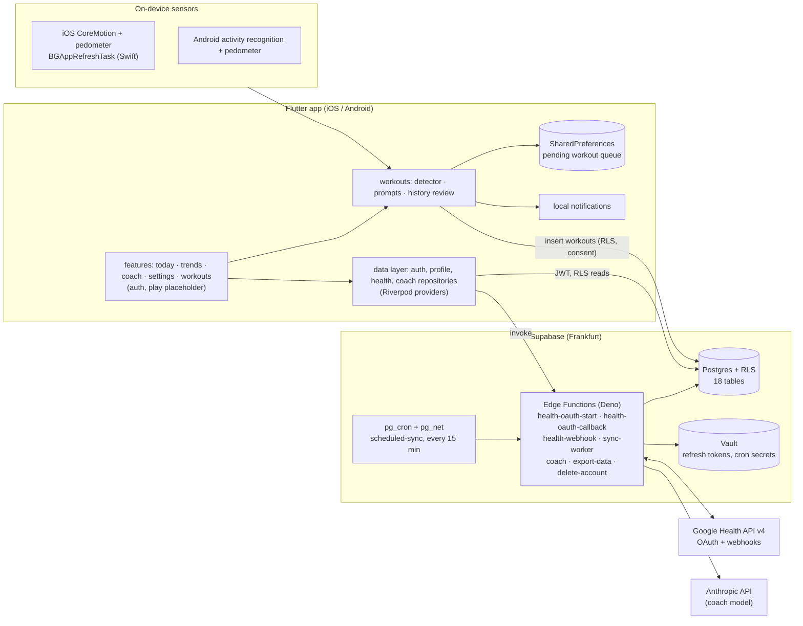
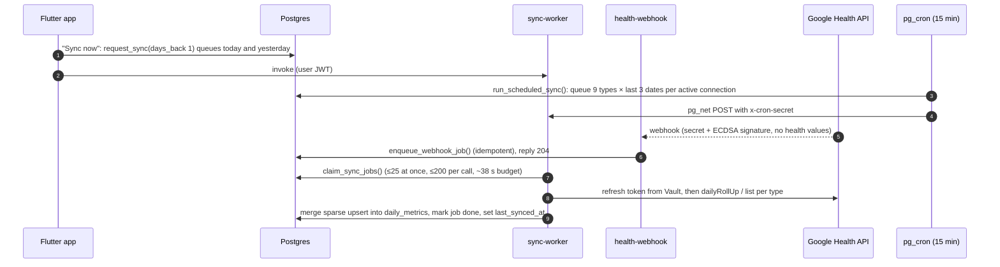
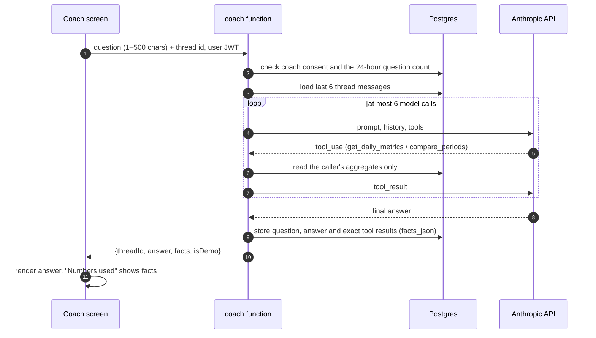
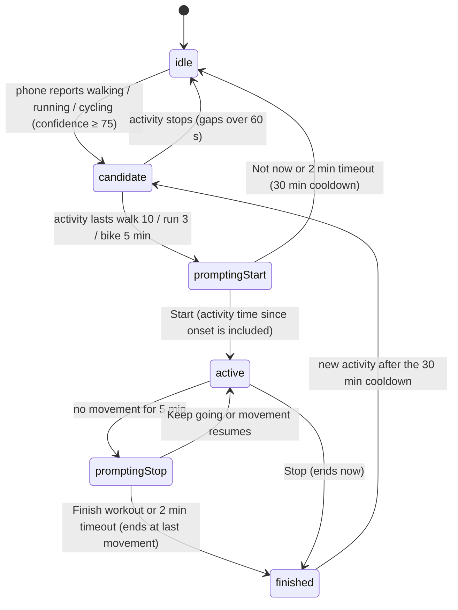
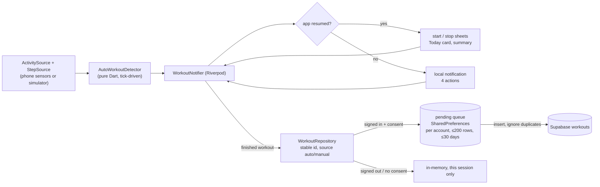
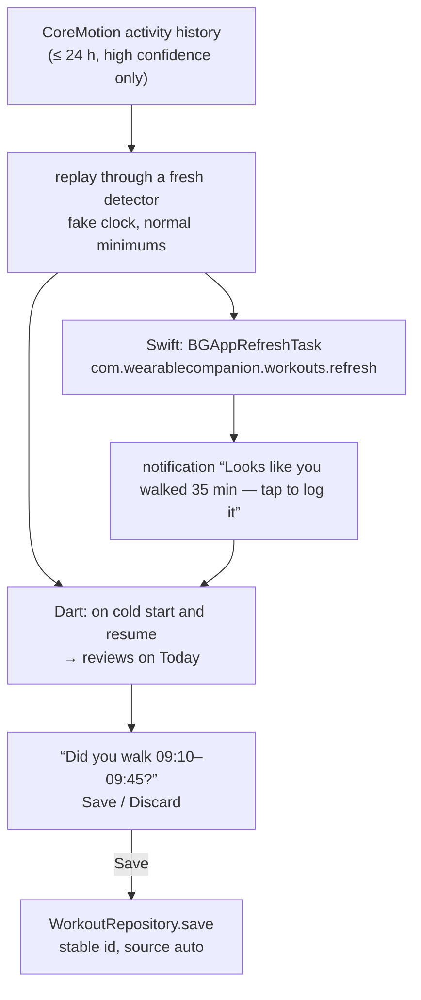
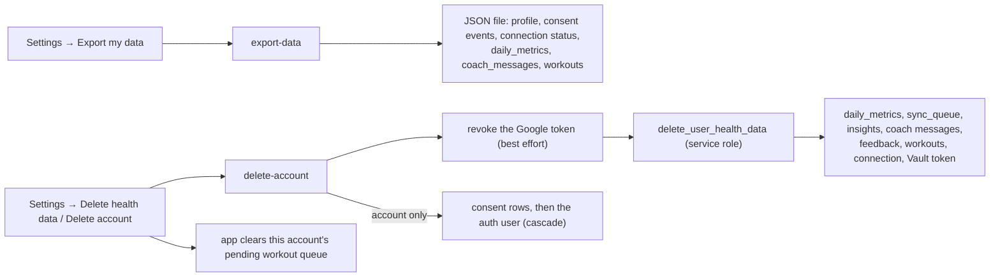

# Wearable Health Companion: Architecture

## Context
We're building a better companion app for Google's $99 Fitbit Air (launched May 2026). It pulls sleep, heart rate and activity through the official **Google Health API (v4)**, shows a one-screen daily summary with weekly and monthly trends, and adds an AI coach (Claude) that explains trends in plain language. The legacy Fitbit Web API was turned off on Nov 2, 2026, so Google Health API v4 is the only option.

**Team and cadence:** two developers, with a progress demo every week. **Platforms:** Android and iOS. Planning and stage status are in [PLAN.md](PLAN.md); the full report is [TECHNICAL_REPORT.md](TECHNICAL_REPORT.md).

**Demo Day targets:** (a) a real Fitbit Air syncing live, (b) 5 users compare our morning summary with the official app, (c) "Why did I sleep badly this week?" answered with the numbers behind it.

---

## 1. Facts from the Google Health API that shape the design
- Base URL: `https://health.googleapis.com/v4`. Auth is Google OAuth 2.0 with scopes `https://www.googleapis.com/auth/googlehealth.{scope}`.
- **Scopes we need (read-only):** `sleep.readonly`, `activity_and_fitness.readonly`, `health_metrics_and_measurements.readonly`, `profile.readonly`.
- **Data types for the MVP:** `sleep`, `daily-resting-heart-rate`, `daily-heart-rate-variability`, `steps`, `active-zone-minutes`, `activity-level` (gives active minutes), `total-calories`, `daily-oxygen-saturation`. We skip intraday `heart-rate` for the MVP.
- **Read method:** `dataPoints:dailyRollUp` (with `windowSizeDays: 1` for one day) for steps, active-zone minutes and calories. Resting HR, HRV, SpO2 and activity level are already daily values and are read with `list` (they have no rollup; see API_NOTES.md). Because these are Google's own daily values, our morning numbers should match the official app, which is what Demo Day target (b) tests. We don't recompute them ourselves.
- **Webhooks:** one subscriber per GCP project with the `AUTOMATIC` policy. Notifications carry metadata only (`healthUserId`, `dataType`, intervals), so we fetch the data afterwards. Each one comes with an `Authorization` secret and an ECDSA P-256 signature (`GOOGLE-HEALTH-API-SIGNATURE`; public keyset on gstatic, rotated every 30 days). We must reply 204 quickly, and retries can deliver duplicates.
- **Restricted scopes:** an unverified app is capped at 100 users, which is fine for the demo. Full verification needs a CASA assessment and is out of scope. ⚠️ Google OAuth apps in "Testing" status get refresh tokens that expire after about 7 days. Before the 5-user test we must either publish the consent screen as "In production" (unverified, which shows a warning screen) or plan for weekly re-consent. Verify this in week 1.

## 2. System overview



The app reads its own rows straight from Postgres under RLS. It calls Edge Functions only for work that needs a secret or the service role: connecting Google Health, syncing, the coach, export and deletion. Workouts are the one feature the app writes itself, directly into `workouts` (RLS requires health consent).

**Two-step auth (decided):**
1. **Identity:** native Google Sign-In (`google_sign_in`), then `supabase.auth.signInWithIdToken`. This requests basic scopes only.
2. **Connect Google Health:** the app opens the `health-oauth-start` URL in a browser via `flutter_web_auth_2`. That function builds the Google consent URL with `access_type=offline`, `prompt=consent`, the health scopes, and `state` (a signed, ten-minute nonce tied to the Supabase user). `health-oauth-callback` exchanges the code, calls `users.getIdentity` to get the `healthUserId`, stores the refresh token in Vault through an RPC, queues a backfill (today plus the previous 35 local dates) and redirects to the app deep link `wearablecompanion://connected`.

All Edge Functions run with the gateway JWT check turned off (`supabase/config.toml`) and authenticate inside the handler: a user JWT, the exact service-role key, the cron secret, or Google's webhook secret and signature.

## 3. Data flows

### 3.1 Sync (manual, scheduled, webhook)



- `health-webhook` checks the Authorization secret and the signature, inserts into `sync_queue` (a unique index on user, data type and date while pending collapses duplicates) and returns 204. It does no heavy work and never invokes the worker.
- `scheduled-sync` calls `public.run_scheduled_sync()` every 15 minutes via pg_cron. It queues all nine data types for today and the previous two local dates of every active connection, then calls `sync-worker` through pg_net. Vault supplies `project_url` and `sync_cron_secret`; the matching function secret is `SYNC_CRON_SECRET`. Missing Vault configuration produces a notice after enqueuing.
- `sync-worker` accepts the constant-time cron secret, the service-role bearer, or a verified user JWT. One call runs one bounded pass: it refreshes the access token, reads the affected dates, upserts aggregates, retries transient failures with a backoff of 30 s to 240 s (failing on attempt 5), and records `last_synced_at` only for users with no failure and no pending work. Details: [supabase/functions/README.md](../supabase/functions/README.md).
- First connection runs a 36-date backfill (calories need several requests because of the 14-day rollup limit), then the user taps **Sync now**.
- We store **daily aggregates only**. Raw intraday streams are never stored. Demo rows (`is_demo`) come from the service-only `seed_demo_metrics` RPC.

### 3.2 Coach



- `coach` verifies the session, checks `coach_consent_at` and enforces a rolling 24-hour limit with `coach_messages_today` (default 30, `COACH_DAILY_LIMIT` overrides). Accepted questions count even when the model call fails.
- The official Anthropic SDK calls `COACH_MODEL` (the code default is `claude-opus-5-5`; changing it is a one-line setting) with medium effort and the server-side fallback beta. The manual loop makes at most six calls and preserves every assistant block unchanged.
- The deterministic `get_daily_metrics` and `compare_periods` tools read only the user's aggregates. Ranges are inclusive and at most 92 days. Comparisons drop missing values, need four observations per period and rank the contributing dates. Averages and medians come only from tools, never from the model.
- The stable wellness-only prompt requires dates, numbers and missing-data and demo disclosure, and forbids diagnosis, treatment advice and causal claims. Today, the timezone and demo context go in the first user message.
- Questions and answers are stored in `coach_messages`; assistant `facts_json` holds the exact tool results the app shows as **Numbers used**.
- Measured quality: [COACH_EVAL.md](COACH_EVAL.md).

### 3.3 Workout detection





Detection is live while the app runs. On iPhone it is complemented by two history paths (3.4). Thresholds, tolerances and the Android limitation are in [`app/lib/features/workouts/README.md`](../app/lib/features/workouts/README.md).

### 3.4 History backfill (iPhone)



Reviews are never saved automatically. Separate cursors (`workouts.refresh.checked` for the native task, a per-account checkpoint for Dart) mean a reminder never consumes a review. The shared golden fixture `app/test/fixtures/workout_motion_history.json` keeps the Dart and Swift replay identical.

### 3.5 Export and delete



- `export-data` pages through the caller's own rows. Tokens, Vault IDs and the Google health user ID are not included; the connection appears only as status, timestamps and scopes.
- `delete-account` attempts token revocation, then removes the data through the service-only `delete_user_health_data` function. Health-only deletion records the withdrawal of consent; account deletion also removes consent rows and the auth user, and the remaining rows cascade.
- After a successful server deletion the app clears the account's local pending workouts (`clearLocalWorkoutData`); a failure there is reported but not shown to the user.

## 4. Data model (Postgres)

RLS is enabled on **all 18 tables**. Clients can read their own rows; the service role writes health data. Every `SECURITY DEFINER` function sets `search_path = ''`.

| Table | Purpose and key columns | Written by |
|---|---|---|
| `profiles` | user_id PK, display_name, timezone, `health_consent_at`, `coach_consent_at`, `sharing_consent_at` | trigger on signup; user updates own row |
| `consent_events` | audit trail: kind (`health_data`, `ai_coach`, `friend_sharing`), granted, at. A trigger keeps `profiles.*_consent_at` in step | user inserts |
| `health_connections` | user_id PK, health_user_id UNIQUE, `refresh_token_secret_id` (Vault), scopes, status (active/revoked/error), last_synced_at | service role |
| `daily_metrics` | (user_id, date) PK; sleep (minutes, efficiency, stages, bedtime, wake time), resting_hr, hrv_ms, spo2_avg, steps, active_zone_min, active_min, total_calories, exercise_count, is_demo | service role |
| `sync_queue` | data_type, date, status (pending/running/done/failed), attempts, run_after, last_error; unique pending key | service role |
| `coach_messages` | thread_id, role, content, `facts_json` (tool results), created_at | service role |
| `weekly_insights`, `summary_feedback` | prepared but not used by the app yet | – |
| `workouts` | id (client UUID), user_id, type (walk/run/bike), source (auto/manual), started_at, ended_at, steps, distance_m, calories, weight_kg; checks bound a workout to 24 h | user inserts (RLS requires health consent), deletes own |
| `characters`, `point_events`, `streaks`, `tasks`, `friendships`, `friend_invites`, `challenges`, `challenge_members`, `team_streaks` | game-layer schema (see 7). Present with RLS, **no app or scoring code uses them yet** | – |

Friends could later read each other's data only through the `get_friend_board()` security-definer RPC, which returns public game fields only.

## 5. Flutter app

- **Stack:** Flutter stable, Riverpod, go_router, supabase_flutter, fl_chart, google_sign_in, flutter_web_auth_2, intl, share_plus, flutter_local_notifications, flutter_activity_recognition, pedometer.
- **Layers:** `lib/core` (theme, router, shared widgets), `lib/data` (auth, profile, health and coach repositories and Riverpod providers; screens never call the network directly), `lib/features/<feature>` for each screen. Workouts keep their own `domain/` (detector, backfill, notification bridge), `data/` (sources, repository, pending queue, history source, local notifications) and `ui/`.
- **Navigation:** onboarding and consent → sign in → connect Google Health → shell with four tabs: **Today**, **Trends**, **Coach**, **Settings**. Auto-detect workouts lives on Today and in Settings → Workout detection. The Play screen is a placeholder and is not in the tab bar.
- **Design:** one theme with light and dark modes, shared cards and a usual-range bar. "Usual" is the 28-day median ("typical"); the usual range is the 10th to 90th percentile, never narrower than a fixed margin (15 min of sleep, 2 bpm, 10% of steps).
- **iOS native:** `Runner/WorkoutMotionHistory.swift` (CoreMotion history, pedometer, BGAppRefreshTask, UserDefaults checkpoints) and `RunnerTests`.

## 6. Repo layout

```
wearable-health-companion/
  README.md, .env.example   # every variable name, no values (docs/SETUP.md)
  docs/                     # ARCHITECTURE, PLAN, SETUP, API_NOTES, COACH_EVAL, TECHNICAL_REPORT,
                            # COST_REPORT, USER_GUIDE, IPHONE_TEST_CHECKLIST, USER_TEST_PROTOCOL, screenshots/
  app/                      # Flutter project
    lib/{core,data,features/{auth,today,trends,coach,settings,play,workouts}}
    test/                   # widget, domain and golden tests; test/screenshots (on demand)
    ios/{Runner,RunnerTests}
  supabase/
    migrations/             # init, health_connect, stage5, workouts, workout_bounds
    functions/{_shared,health-oauth-start,health-oauth-callback,health-webhook,sync-worker,coach,export-data,delete-account}/
    config.toml
```

Development runs against a hosted Supabase dev project, because webhooks need a public HTTPS endpoint. Local Supabase covers schema and unit work.

## 7. Not built (planned in the first draft)

The original plan included a game layer: character and mood, deterministic points, streaks, tasks, friends, challenges and push notifications. The tables exist, but there is no scoring engine, no Edge Function and no UI beyond the Play placeholder. They stay out of the required MVP (see PLAN.md, "Optional, only after every required flow works"). If built, the principles stay: points computed server-side from `daily_metrics`, never by the model; friends see public game fields only and sharing is opt-in with its own consent event.

## 8. Risks
- Testing-mode refresh tokens expire after about 7 days (section 1). Publish the consent screen or have testers reconnect weekly.
- Fitbit Air may not report every data type (SpO2 and HRV are device-dependent). The UI hides cards with no data.
- Webhook timing is unpredictable for a live demo. Mitigation: **Sync now** plus a pre-connected demo account.
- Timezones: dailyRollUp uses civil dates. We store the user's timezone and key everything by local date. Timezone validation is in the report's known risks.
- iPhone background and CoreMotion behaviour has not been verified on a device; see [IPHONE_TEST_CHECKLIST.md](IPHONE_TEST_CHECKLIST.md).

## Verification
- `supabase db reset` applies the migrations; the database layer was also tested on a real PostgreSQL with separate users (see the report's security section).
- Deno tests for the Edge Functions and shared code (signature verification, queue idempotency, mapping, coach tools and handler): `npx -y deno test --config supabase/functions/deno.json supabase/functions`.
- Flutter tests: `cd app && flutter test` (widget, domain, repository and golden tests). Screenshot generation: `SCREENSHOTS=1 flutter test --tags screenshots test/screenshots`.
- Coach evaluation: 26 questions over 8 fixture users, three repeats each ([COACH_EVAL.md](COACH_EVAL.md)).
- Connect a real Fitbit Air account and compare the last 7 days of `daily_metrics` with the Google Health app by hand.

Sources: developers.google.com/health/webhooks, /health/migration/api-specifications, /health/app-verification, /health/release-notes
