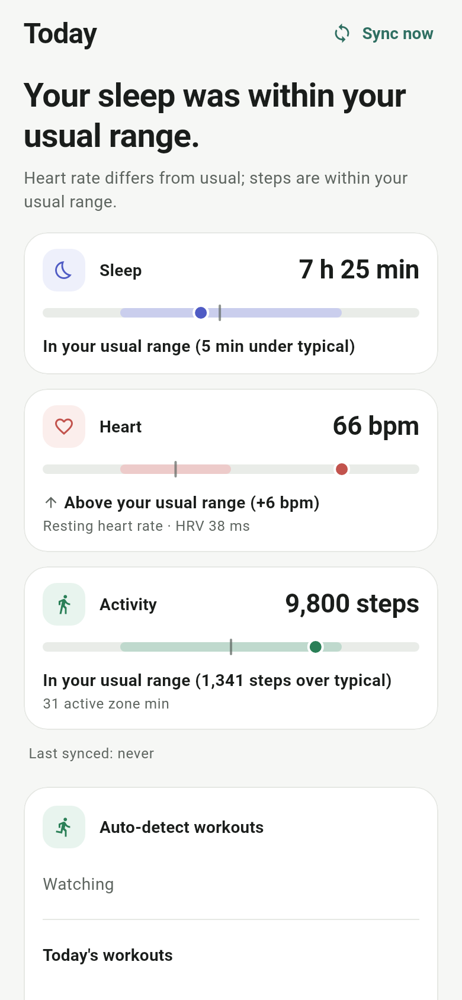
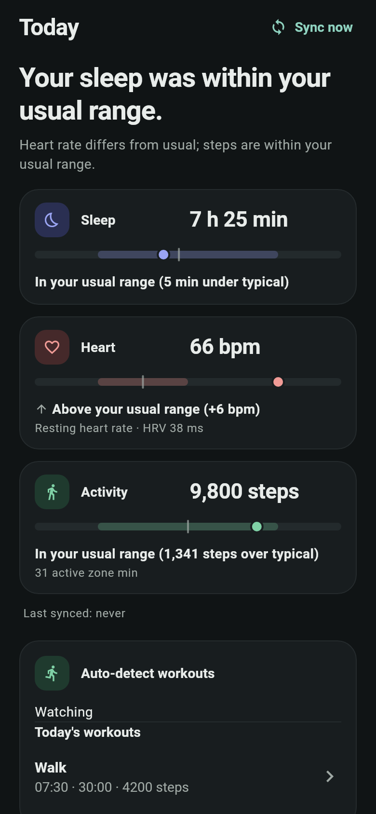
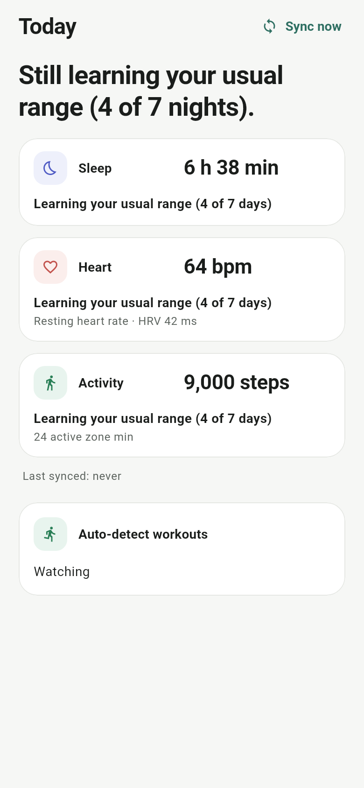
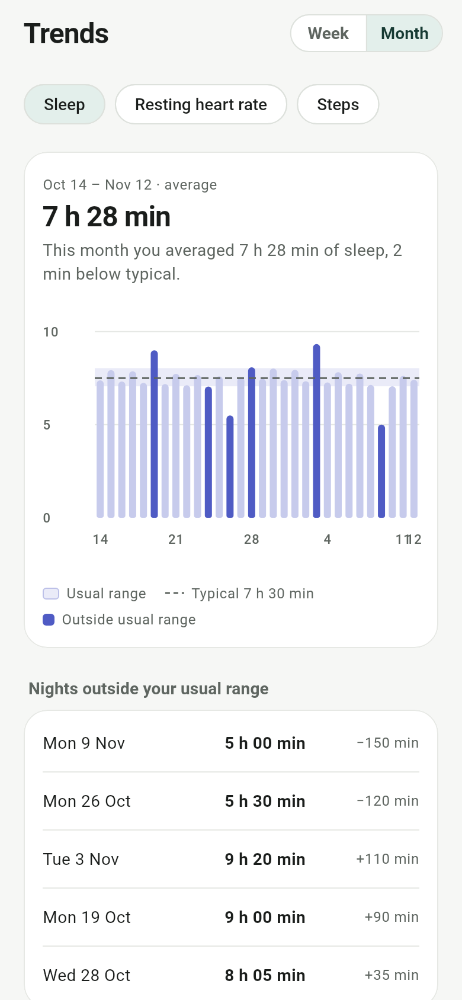
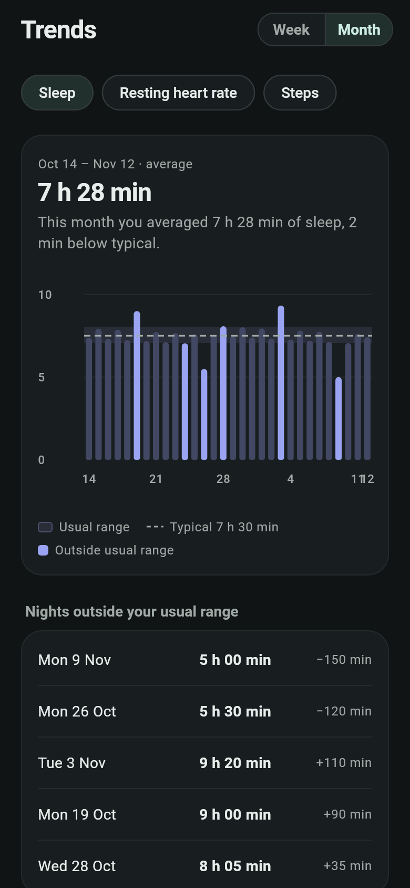
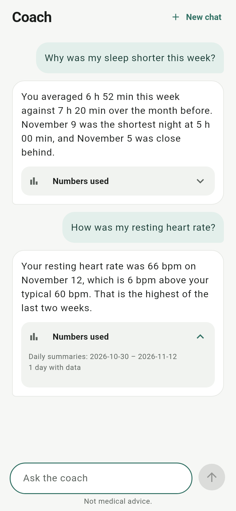
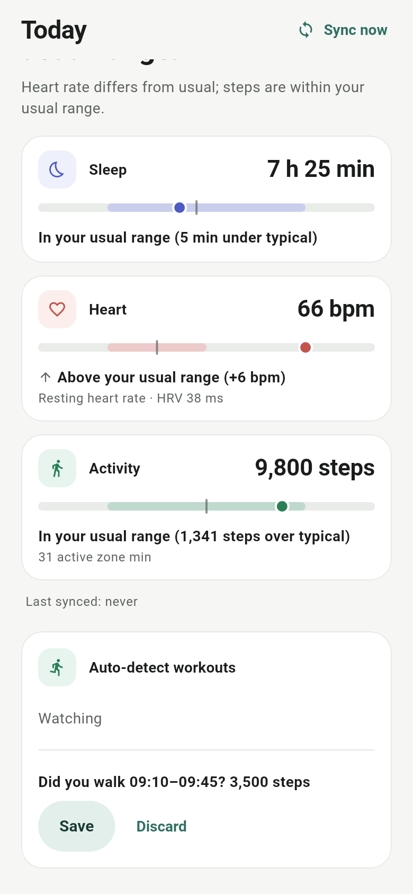
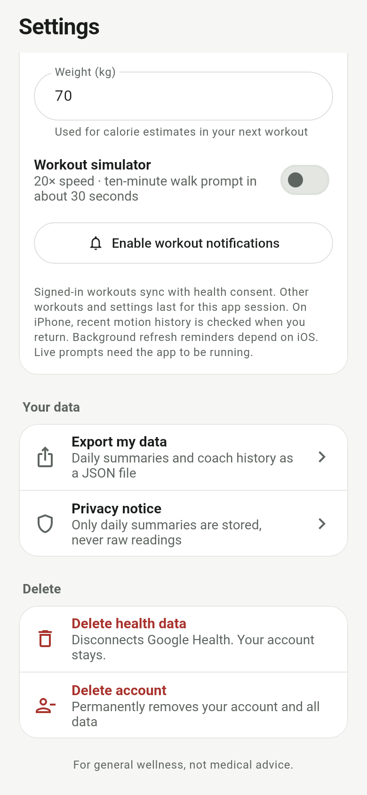

# User guide

Wearable Health Companion shows what changed in your sleep, heart rate and activity compared with your own usual, in about ten seconds. It is for general wellness and is **not medical advice**.

Screenshots are in [screenshots/](screenshots/); they show demo data in light and dark mode.

**Demo mode.** If the app is built with `--dart-define=DEMO_MODE=true`, it opens full of sample data without any sign-in or device (see the README). Every screen then shows a "Demo data" label; the coach answers only with prepared replies, and export and delete are disabled.

## 1. Sign in and health consent

1. Open the app and read the short introduction, then tap **Continue**.
2. **Sign in** with your Google account. This step shares only your basic identity, such as your name and email.
3. Read **Your health-data consent**. We read sleep, heart rate and activity from Google Health to show your summary, trends and coach answers. Only daily summaries are stored, never raw readings.
4. Tap **I agree** to continue, or **Not now** to use the app without connecting. You can connect later from Settings, and remove your health data any time with **Delete health data**.

## 2. Connect Google Health

1. Tap **Connect Google Health**. Google asks you to approve read access in a secure browser window.
2. Back in the app, open **Today** and tap **Sync now** to fetch your first daily summary. Later syncs run on their own; **Sync now** is always there as a manual option.
3. If your Google account has never set up the Fitbit or Google Health app, the app asks you to set it up first.
4. You can skip this step. Until you connect, Today shows sample data when it is available, clearly labelled **Demo data** and "Sample data, not from your device."

Data reaches the app only after your device has synced through the Google Health app. If last night is missing, sync your device there first.

## 3. Today

 

- **Lead sentence.** The big sentence at the top is the main thing that changed, for example "You slept 52 min less than typical." When your sleep is inside your usual range it reads "Your sleep was within your usual range." Heart rate and steps get one line underneath.
- **Typical and usual range.** Two words matter:
  - **Typical** is the median of your previous 28 days.
  - **Usual range** is the band your days normally fall in (roughly the middle 80%, never narrower than a small fixed margin: 15 minutes of sleep, 2 bpm, or 10% of steps). A day inside the band is "in your usual range"; a day outside it is "Below" or "Above your usual range", with the gap in brackets.
- **Range bars.** Each card draws the band as a tinted strip, a thin tick for typical and a dot for today. A dot inside the strip is a normal day. An arrow appears only when you are outside the band.
- **Still learning.** Until there are 7 days of data, Today says "Still learning your usual range (4 of 7 nights)" and shows plain values.
- **Tap a card** to open that metric's chart in Trends.

## 4. Trends

 

- Choose **Sleep**, **Resting heart rate** or **Steps**, and **Week** or **Month**.
- The tinted band is your usual range and the dashed line is typical. Bars inside the band are muted so the days that stand out are easy to see.
- Below the chart, **Nights / Days outside your usual range** lists the days that fell outside, largest difference first, with how far off they were.
- A small dash under the axis marks a day with no data. Missing days are left out of averages, never counted as zero.
- **Ask the coach** at the bottom opens the coach with a question about the period you are looking at.

## 5. Coach

The coach answers in plain language from **your own daily data** only. Try:

- "Why did I sleep badly this week?"
- "How was my resting heart rate this month?"
- "Which days was I most active?"

Tips:

- Every answer names the dates and numbers behind it. Tap **Numbers used** under an answer to see them.
- If a period has fewer than 4 days of data, the coach says it is too incomplete to compare.
- It describes patterns ("on these nights you also…"), never causes.
- It is **not a medical service**: it will not diagnose, suggest treatment or medication, or answer medical questions. For those, talk to a doctor. The note "Not medical advice." is always shown.
- Before first use, the coach asks for a separate consent because your daily summaries are sent to an AI service to answer. **New chat** starts a fresh conversation.

## 6. Workout detection

The app can notice a walk, run or bike ride and ask whether to log it. Settings → **Workouts** → **Workout detection** controls it.

- **Auto-start prompts** ask before starting a detected workout; **Auto-stop prompts** ask after 5 minutes without movement. Both are on by default.
- Detection needs about 10 minutes of walking, 3 of running or 5 of cycling before it asks.
- **While the app is open**, a prompt appears as a sheet with a countdown ("Start walk?"). You can start another type instead, or decline. The **Auto-detect workouts** card on Today shows what is being watched, the live clock of a running workout, and **Today's workouts** once they are saved.
- **While the app is in the background**, tap **Enable workout notifications** in Settings (the app never asks implicitly). Prompts then arrive as notifications with actions: **Start** / **Not now** for a start, **Stop** / **Keep going** for a stop. Tapping the notification opens the same sheet.
- **"Did you walk 09:10–09:45?"** On iPhone, the app also checks recent motion history when you return and offers finished workouts it missed as suggestions with **Save** or **Discard**. Nothing is saved without your choice. iOS decides if and when a background reminder ("Looks like you walked 35 min — tap to log it") is delivered, and it is delivered less reliably if Background App Refresh is off or the app was force-quit.
- Android shows live notifications only; it has no history suggestions yet.
- Settings keeps your **weight** for calorie estimates. A finished workout is listed as, for example, "07:30 · 30 min · 4,200 steps"; a running one shows a stopwatch. Bike rides do not count steps or distance ("Distance isn't measured for bike rides"); their calories are estimated from duration and weight.
- **Workout simulator** (for demos): runs at 20× speed and updates every 4 seconds. Switch it on, tap **Simulate walk**, **Simulate run** or **Simulate bike**, accept the start prompt (a walk prompt appears after about 32 seconds), then tap **Stop moving** to see the stop prompt. **Finish workout** ends the workout at your last movement.

 

## 7. Export and delete

All under **Settings**:

- **Export my data** shares your daily summaries and coach history as a JSON file named `wearable-companion-export-<date>.json`.
- **Privacy notice** repeats what is read and stored.
- **Delete health data** disconnects Google Health and removes the health data stored for you; your account stays.
- **Delete account** permanently removes your account and all data and revokes access.
- **Sign out** is on the account card at the top.
